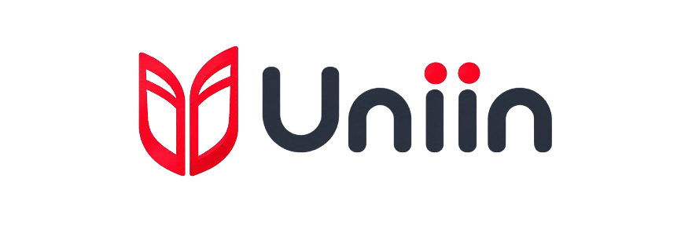

<div align="center">
  
</div>

<div align="center">
  <a href="https://doniyorweb.uz">
    
  </a>
</div>

<div align="center">

  [](https://doniyorweb.uz)
  [](https://t.me/Musayev_Doniyor)
  [](https://www.linkedin.com/in/doniyor-musayev/)
  [](mailto:doniyormusayev2009@gmail.com)
  [](https://github.com/MusayevDoniyor)

</div>

<br/>

```jsonc
// ⚡ Terminal: doniyor@tashkent ~
{
  "name": "Doniyor Musayev",
  "age": "17 y.o. (Oct 15, 2009)",
  "origin": "Tashkent, Uzbekistan",
  "education": "TUIT Academic Lyceum (Economics & Tech, 2025-2027)",
  "languages": "English (IELTS 7.5 - C1) · Uzbek (Native) · Russian",
  "roles": [
    "Co-Founder & CTO @ Uniin & Sadoo",
    "Startup Ambassador @ Yoshlar Ventures",
    "Systems Architect @ UzCombinator Founders' Camp",
    "Software Engineer @ TopCoach"
  ],
  "building": "Full-stack platforms, autonomous AI agents, and 3D physics simulators."
}
```

---

## 🏆 Hackathons & Leadership

| | Event | Result |
|---|---|---|
| 🥉 | **GDG × New Uzbekistan University Hackathon** | 3rd Place (Bronze) |
| 🏆 | **National AI500 Hackathon** | Finalist (Top 13%) |
| 🎖️ | **Regional Innovation Hackathon (Bitrix)** | Finalist |
| 🌐 | **Silk Road Finance & Tech Forum (2026)** | Youth Delegate |
| ⚡ | **Fellowships** | UzCombinator · Startup Ambassadors · Top100Uni |
| 🎯 | **IELTS Academic** | Band 7.5 (C1 Advanced) |

---

## 🚀 Flagship Projects

<table>
  <tr>
    <td width="50%">
      <a href="https://artemis-odyssey-psi.vercel.app">
        
      </a>
      <br/>
      <h3 align="center">🛰️ Artemis Odyssey</h3>
      <p align="center"><b>3D Spaceflight & Lunar Rover Physics Simulator</b></p>
      <p align="center">
        <a href="https://artemis-odyssey-psi.vercel.app"><b>🚀 Live Demo</b></a> · <a href="https://github.com/MusayevDoniyor/Artemis-Odyssey-3d-Mission-Simulator"><b>💻 Code</b></a>
      </p>
      <p align="center">
        
        
        
      </p>
    </td>
    <td width="50%">
      <a href="https://github.com/MusayevDoniyor/kaizumi">
        
      </a>
      <br/>
      <h3 align="center">🎙️ Kaizumi Voice AI</h3>
      <p align="center"><b>Desktop Multimodal AI Agent</b> · ⭐ 7</p>
      <p align="center">
        <a href="https://github.com/MusayevDoniyor/kaizumi"><b>⭐ Repository</b></a>
      </p>
      <p align="center">
        
        
        
      </p>
    </td>
  </tr>
  <tr>
    <td width="50%">
      <a href="https://uniin.uz">
        
      </a>
      <br/>
      <h3 align="center">🎓 Uniin Network</h3>
      <p align="center"><b>Academic Social Platform</b> · <a href="https://uniin.uz">uniin.uz</a></p>
      <p align="center">
        <a href="https://uniin.uz"><b>🌐 Live</b></a>
      </p>
      <p align="center">
        
        
        
      </p>
    </td>
    <td width="50%">
      <a href="https://github.com/MusayevDoniyor/uzex-ai-agent">
        
      </a>
      <br/>
      <h3 align="center">🤖 Uzex AI Agent</h3>
      <p align="center"><b>Commodity Intelligence Engine</b> · 500K+ trades</p>
      <p align="center">
        <a href="https://github.com/MusayevDoniyor/uzex-ai-agent"><b>💻 Repository</b></a>
      </p>
      <p align="center">
        
        
        
      </p>
    </td>
  </tr>
</table>

---

## 🛠️ Tech Stack

<div align="center">

**Languages**

<a href="https://skillicons.dev"></a>

**Frontend & 3D**

<a href="https://skillicons.dev"></a>

**Backend**

<a href="https://skillicons.dev"></a>

**Databases**

<a href="https://skillicons.dev"></a>

**DevOps & Cloud**

<a href="https://skillicons.dev"></a>

</div>

---

## 📊 GitHub Stats

<div align="center">
  
  
</div>

<div align="center">
  
</div>

<div align="center">
  
</div>

---

<div align="center">

  [](https://doniyorweb.uz)
  [](https://t.me/Musayev_Doniyor)
  [](https://www.linkedin.com/in/doniyor-musayev/)
  [](mailto:doniyormusayev2009@gmail.com)

  

</div>
