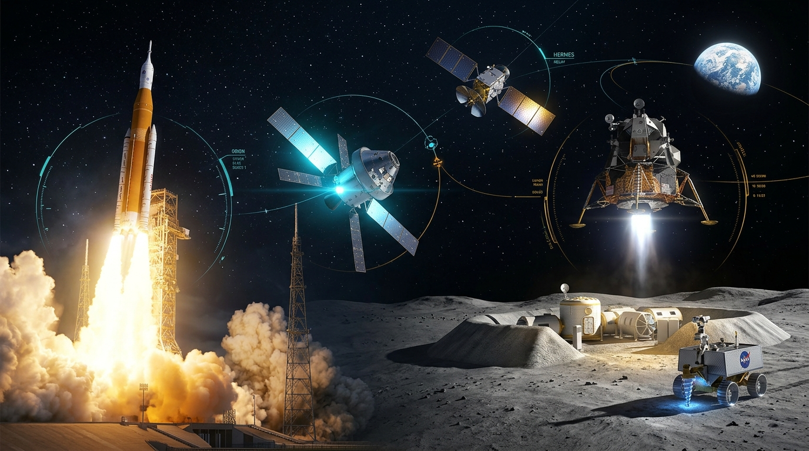
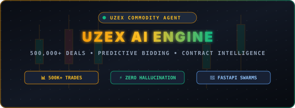
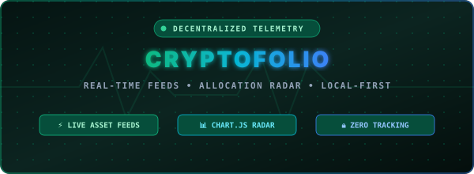
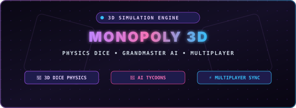

  

# Doniyor Musayev

**Full-Stack Developer · AI Systems Builder · Startup Co-Founder & CTO**  
Tashkent, Uzbekistan · [doniyorweb.uz](https://doniyorweb.uz) · [LinkedIn](https://www.linkedin.com/in/doniyor-musayev/) · [Telegram](https://t.me/Musayev_Doniyor) · [Email](mailto:doniyormusayev2009@gmail.com)

[-10B981?style=for-the-badge)](https://doniyorweb.uz)

---

### 👨‍💻 About Me

I am a systems-focused full-stack developer, AI engineer, and startup CTO building scalable web platforms, multimodal AI systems, and interactive 3D simulations.

- 🚀 **Co-Founder & CTO at [Uniin](https://uniin.uz)**: Architecting the student network for university applicants (Next.js 15, NestJS 10, Prisma 7, PostgreSQL, LiveKit, WebSockets).
- 🤖 **Autonomous AI Systems**: Creator of **[Kaizumi](https://github.com/MusayevDoniyor/kaizumi)** (real-time voice & computer vision desktop assistant) and **[UZEX AI Agent](https://github.com/MusayevDoniyor/uzex-ai-agent)** (commodity exchange intelligence MCP server over 500k deals).
- 🔭 **Interactive 3D & Physics**: NASA Space Apps Challenge creator of **[Artemis Odyssey](https://artemis-odyssey-psi.vercel.app)** (analytical Keplerian orbital mechanics & lunar rover physics).
- 🏛️ **Ecosystem Leadership**: Startup Ambassador at Yoshlar Ventures, UzCombinator Founders' Camp alumnus, and student at Muhammad al-Xorazmiy TUIT Academic Lyceum.

---

### 💼 Startup & Engineering Leadership

| Role | Organization | Core Technical Focus | Status |
|---|---|---|---|
| **Co-Founder & CTO** | **[Uniin](https://uniin.uz)** | Real-time messaging, feed algorithms, university applicant telemetry, NestJS 10 + Next.js 15 + Prisma 7 architecture. | Production |
| **Co-Founder & Architect** | **Sadoo** | Multimodal agentic workflows, operator copilot, Cloudflare Workers & TanStack Start edge services. | Active |
| **Startup Ambassador** | **Yoshlar Ventures** | Mentoring youth builders, hackathon organizing, connecting regional developers with startup ecosystem. | Ongoing |
| **Fellow & Systems Builder** | **UzCombinator** | Intensive venture engineering, scalable SaaS deployment, and product-market validation. | Alumnus |

---

### 🏆 Honors & Hackathons

- 🥉 **3rd Place (Bronze)** — GDG × New Uzbekistan University Hackathon
- 🏆 **National Finalist (Top 13%)** — National AI500 Hackathon (Kaizumi Voice AI)
- 🎖️ **Finalist** — Regional Innovation Hackathon (Bitrix24)
- 🌐 **Youth Delegate** — Silk Road Finance & Tech Forum (2026)
- 🎯 **IELTS Academic** — Band 7.5 (C1 Advanced)

---

### 🚀 Selected Flagship Projects

<table>
  <tr>
    <td width="50%" valign="top">
      
      <h3 align="center">🎓 Uniin Network</h3>
      
<b>Unified Student Network for University Applicants</b>

      
Co-Founder & CTO. Full-stack academic social platform featuring real-time messaging, community groups, applicant verification feeds, and LiveKit interactive audio/video sessions.

      

        <a href="https://uniin.uz"><b>🌐 Live Platform (uniin.uz)</b></a>
      

      

        <code>Next.js 15</code> · <code>NestJS 10</code> · <code>Prisma 7</code> · <code>PostgreSQL</code> · <code>LiveKit</code>
      

    </td>
    <td width="50%" valign="top">
      
      <h3 align="center">🛰️ Artemis Odyssey</h3>
      
<b>3D Spaceflight & Lunar Rover Simulator</b>

      
NASA Space Apps Challenge project. Implements analytical Keplerian orbital mechanics, Trans-Lunar Injection (TLI), Gateway NRHO rendezvous, and real-time lunar rover surface physics.

      

        <a href="https://artemis-odyssey-psi.vercel.app"><b>🚀 Live Simulator</b></a> · <a href="https://github.com/MusayevDoniyor/Artemis-Odyssey-3d-Mission-Simulator"><b>💻 Code</b></a>
      

      

        <code>Three.js</code> · <code>TypeScript</code> · <code>WebGL Shaders</code> · <code>Vite</code>
      

    </td>
  </tr>
  <tr>
    <td width="50%" valign="top">
      
      <h3 align="center">🎙️ Kaizumi Voice AI</h3>
      
<b>Desktop Multimodal Autonomous Companion · ⭐ 7</b>

      
Sub-second speech-to-speech interaction, computer vision screen comprehension, local Windows OS automation, and strict safety guardrails powered by Gemini Multimodal Live API.

      

        <a href="https://github.com/MusayevDoniyor/kaizumi"><b>⭐ GitHub Repository</b></a>
      

      

        <code>Python</code> · <code>Gemini Multimodal</code> · <code>Speech-to-Speech</code> · <code>AsyncIO</code>
      

    </td>
    <td width="50%" valign="top">
      
      <h3 align="center">🏛️ UZEX Market Intelligence AI</h3>
      
<b>Commodity Exchange Analytics & MCP Server</b>

      
Enterprise AI agent processing 500,000+ commodity trades with zero-hallucination Text-to-SQL, intelligent schema validation, Claude Code MCP server support, and Gemini/Groq failover.

      

        <a href="https://github.com/MusayevDoniyor/uzex-ai-agent"><b>💻 GitHub Repository</b></a>
      

      

        <code>FastAPI</code> · <code>MCP Protocol</code> · <code>Text-to-SQL</code> · <code>Docker</code>
      

    </td>
  </tr>
  <tr>
    <td width="50%" valign="top">
      
      <h3 align="center">📐 MathBro AI</h3>
      
<b>Step-by-Step Problem Solver & Weak-Area Diagnostic SaaS</b>

      
Full-stack educational platform with AI step-by-step problem deconstruction, personalized weak-area diagnostic telemetry, formula revision vault, and LaTeX formatting.

      

        <a href="https://mathbro.doniyorlab.uz/"><b>🌐 Live SaaS</b></a> · <a href="https://github.com/MusayevDoniyor/mathbro"><b>💻 Code</b></a>
      

      

        <code>Next.js 15</code> · <code>Prisma ORM</code> · <code>PostgreSQL</code> · <code>Recharts</code>
      

    </td>
    <td width="50%" valign="top">
      
      <h3 align="center">🎲 Monopoly Deluxe Edition</h3>
      
<b>Full Game Engine with 3D Dice Physics & Grandmaster AI</b>

      
Complete digital board game implementation with 3D physics dice rolls, dynamic property mortgaging/auctions, multi-bot heuristic AI tycoons, and Electron desktop cross-compilation.

      

        <a href="https://monopoly-master.onrender.com"><b>🎲 Live Play</b></a> · <a href="https://github.com/MusayevDoniyor/monopoly-game"><b>💻 Code</b></a>
      

      

        <code>JavaScript / TS</code> · <code>Three.js Physics</code> · <code>Electron</code> · <code>State Machine</code>
      

    </td>
  </tr>
  <tr>
    <td width="50%" valign="top">
      
      <h3 align="center">🧑‍💻 MyCVBuilder</h3>
      
<b>Real-Time ATS Resume Builder & Client-Side PDF Engine</b>

      
Interactive CV generator with dynamic ATS readability scoring, 6 modern templates, live A4 print preview, dark mode, and zero-server client-side PDF compilation.

      

        <a href="https://my-cv-builder.doniyorlab.uz/"><b>🚀 Live App</b></a> · <a href="https://github.com/MusayevDoniyor/MyCVBuilder"><b>💻 Code</b></a>
      

      

        <code>React</code> · <code>TypeScript</code> · <code>Tailwind CSS</code> · <code>Zustand</code>
      

    </td>
    <td width="50%" valign="top">
      
      <h3 align="center">⚡ Real-Time Voting Engine</h3>
      
<b>Enterprise NestJS + Apollo GraphQL Subscriptions & Redis</b>

      
High-concurrency voting architecture with live WebSocket tally push, Apollo GraphQL subscriptions, Redis Throttler rate limiting, PostgreSQL + TypeORM, and Swagger docs.

      

        <a href="https://github.com/MusayevDoniyor/Real-Time-Voting-System"><b>💻 GitHub Repository</b></a>
      

      

        <code>NestJS</code> · <code>GraphQL Apollo</code> · <code>Redis</code> · <code>PostgreSQL</code>
      

    </td>
  </tr>
</table>

---

### 🛠️ Technical Stack Matrix

- **Languages:** TypeScript, JavaScript, Python, C++, SQL, HTML5/CSS3, SCSS
- **Frontend & 3D:** Next.js 15 (App Router), React 19/18, Tailwind CSS v4, Three.js, WebGL Shaders, Framer Motion, TanStack Start, Zustand, Redux Toolkit
- **Backend & Distributed:** NestJS 10, Node.js, Express, FastAPI, GraphQL (Apollo), RESTful APIs, WebSockets / Socket.IO
- **Databases & ORMs:** PostgreSQL, Prisma 7, TypeORM, Supabase, Redis, SQLite
- **AI Systems & Agents:** Gemini Multimodal Live API, Anthropic Claude Code MCP, Groq, Text-to-SQL, Vector Embeddings
- **DevOps & Infrastructure:** Docker, Docker Compose, Git, GitHub Actions CI/CD, Vercel, Render, Cloudflare Workers, Linux

---

### 📬 Connect & Verify

- **Personal Portfolio:** [doniyorweb.uz](https://doniyorweb.uz)
- **LinkedIn:** [linkedin.com/in/doniyor-musayev](https://www.linkedin.com/in/doniyor-musayev/)
- **Telegram:** [@Musayev_Doniyor](https://t.me/Musayev_Doniyor)
- **Email:** [doniyormusayev2009@gmail.com](mailto:doniyormusayev2009@gmail.com)
